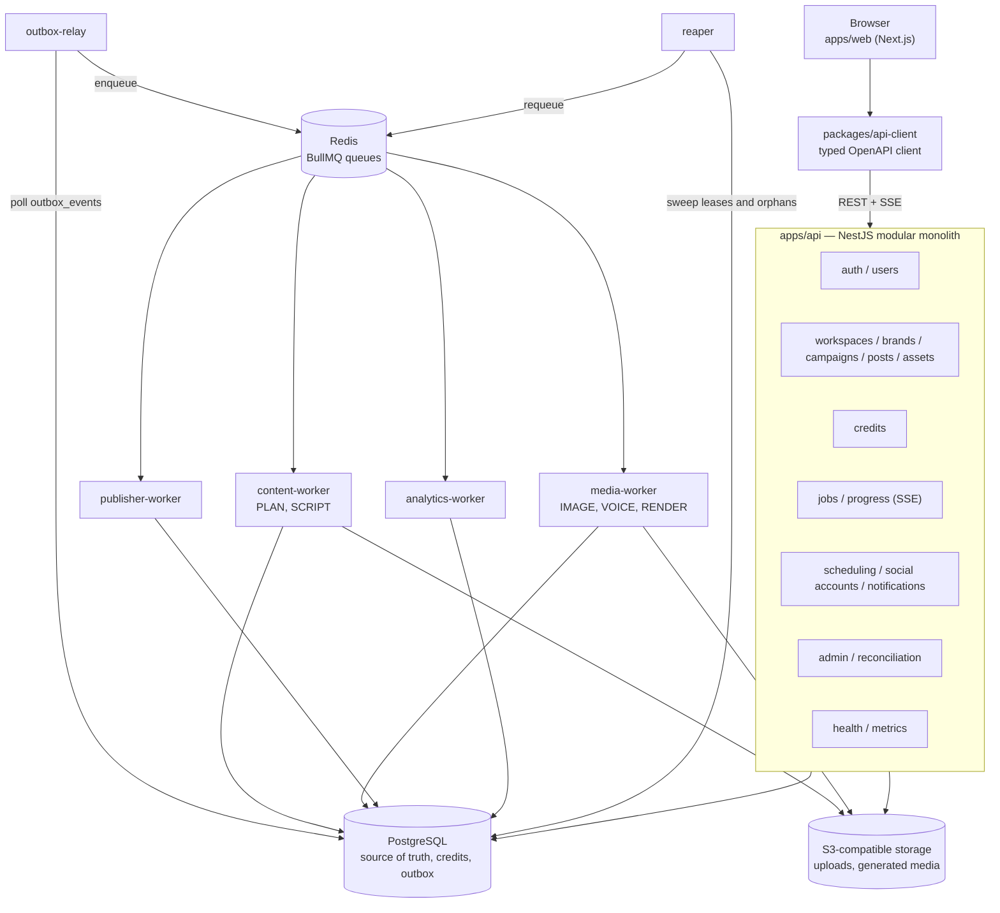

# Architecture

RenderFlow is a modular monolith with separate worker processes. A single NestJS
API owns all HTTP and all credit-moving transactions. Workers consume jobs from
Redis/BullMQ and persist their progress in PostgreSQL. A transactional outbox
connects database commits to queue delivery, so a crash between the two cannot
lose work.

This document describes the system as it exists in the repository. It does not
describe a future microservice split. The phase-by-phase status is in
[`PHASES.md`](./PHASES.md), and the authoritative specification is
[`PROJECT.md`](./PROJECT.md).

**Verified against:** repository at 2026-11-01.

## 1. Runtime shape



| Process            | Responsibility                                                                                       | State it owns                                                     |
| ------------------ | ---------------------------------------------------------------------------------------------------- | ----------------------------------------------------------------- |
| `apps/web`         | Public marketing pages and the authenticated product UI.                                             | Browser state only; theme preference in `localStorage`.           |
| `apps/api`         | All HTTP, authentication, tenancy, credits, job creation, scheduling, analytics reads, admin routes. | PostgreSQL; S3 presigned URLs.                                    |
| `outbox-relay`     | Reads unprocessed `outbox_events` and publishes them to BullMQ.                                      | None; PostgreSQL is the queue of record.                          |
| `content-worker`   | Runs `PLAN` and `SCRIPT` stages against text providers.                                              | Job leases, checkpoints, artefacts in S3.                         |
| `media-worker`     | Runs `IMAGE`, `VOICE` and `RENDER` stages, including FFmpeg.                                         | Job leases, checkpoints, artefacts in S3.                         |
| `publisher-worker` | Claims due `publish_jobs`, publishes to social adapters, records `external_post_id`.                 | Publish leases, publish history, notifications.                   |
| `analytics-worker` | Polls published posts for metrics and stores periodic snapshots.                                     | `post_metrics`; Postgres advisory lock for single-leader polling. |
| `reaper`           | Recovers expired job leases, orphaned `PENDING` jobs and stale publish jobs.                         | PostgreSQL advisory lock; no queue ownership.                     |
| PostgreSQL         | Source of truth for users, credits, content, schedules, job state and the outbox.                    | Durable.                                                          |
| Redis              | BullMQ transport and delayed wake-ups.                                                               | Disposable. Losing it costs latency, not data.                    |
| S3                 | Uploaded assets and generated media.                                                                 | Durable; keys are referenced from PostgreSQL.                     |

The dependency rule is one-way: `apps/*` may import `libs/*`; `libs/*` never
imports an app, and apps never import each other. Cross-app communication is
through PostgreSQL, the outbox and queues.

## 2. HTTP API

The API listens on `API_PORT` (default `4000`) and mounts versioned routes under
`/api/v1`. Four routes sit outside the prefix so orchestrators and Prometheus do
not need to know the API version:

| Route           | Purpose                                             |
| --------------- | --------------------------------------------------- |
| `/health/live`  | Process liveness. No dependency I/O.                |
| `/health/ready` | Readiness report. See the caveat below.             |
| `/metrics`      | Prometheus text exposition.                         |
| `/docs-json`    | OpenAPI 3 document. Swagger UI is development-only. |

> **Readiness caveat.** `HealthService` supports registered probes, but the
> running API currently registers none. `/health/ready` therefore returns
> `{ "status": "ok", "checks": {} }` without testing PostgreSQL, Redis or S3.
> Use `/health/live` for liveness and monitor the real dependencies directly
> until probes are wired. Do not treat `/health/ready` as proof of dependency
> health.

The global guard chain is deny-by-default:

1. pre-authentication rate limit (IP/email scoped),
2. CSRF check for cookie-authenticated unsafe methods,
3. authentication (`rf_access` cookie or `Authorization: Bearer`),
4. post-authentication rate limit (user scoped),
5. global role guard.

`@Public()` is the explicit opt-out used by auth, health, metrics and the OpenAPI
document. The API is described in more detail in [`SECURITY.md`](./SECURITY.md).

Modules expose services to each other; they do not reach into another module's
repository. The main modules are auth, users, credits, jobs, workspaces/studio,
publishing, analytics, admin, health and metrics.

## 3. Data model

All schema changes go through Drizzle migrations in `libs/db/drizzle`. The
TypeScript schema in `libs/db/src/schema.ts` also declares the constraints and
partial indexes that protect credits.

| Cluster       | Tables                                                   | Notes                                                                         |
| ------------- | -------------------------------------------------------- | ----------------------------------------------------------------------------- |
| Identity      | `users`, `refresh_sessions`, `auth_tokens`               | Refresh tokens stored as hashes; one-shot auth tokens for reset/verification. |
| Credits       | `wallets`, `credit_ledger`, `pricing_rules`              | Only `libs/credits` writes the first two.                                     |
| Tenancy       | `workspaces`, `workspace_members`                        | Roles: `OWNER`, `EDITOR`, `APPROVER`, `VIEWER`.                               |
| Studio        | `brands`, `brand_memory`, `campaigns`, `posts`, `assets` | Assets reference S3 keys; uploads are presigned.                              |
| Generation    | `generation_jobs`, `job_checkpoints`                     | Durable retry counter, lease and stage checkpoints.                           |
| Publishing    | `social_accounts`, `publish_jobs`                        | Social tokens encrypted; publish jobs carry lease and idempotency keys.       |
| Analytics     | `post_metrics`                                           | One snapshot per publish job and fetch time.                                  |
| Coordination  | `outbox_events`                                          | Transactional outbox; unique dedupe key per logical event.                    |
| Notifications | `notifications`                                          | In-app notification centre; dedupe key prevents retry spam.                   |
| Audit         | `audit_logs`                                             | Operator adjustments, replays and related actions.                            |

The reviewed indexes and the query each supports are documented in
[`docs/index-review.md`](./docs/index-review.md). Integration tests pin the
survivors.

### Tenancy

Every workspace-scoped request resolves the caller's membership and required
role through `WorkspaceAccessService`. Brand, campaign, post, asset, social
account and publish queries are then filtered by the workspace they belong to.
A global `ADMIN` is the only role that can read across workspaces. A workspace
`OWNER` only sees the workspaces they own.

### Money representation

Credits are integers. There are no floating-point balances. Dates are stored as
`timestamptz` in UTC. Wallet columns are caches of an append-only ledger, not an
independent source of truth.

## 4. Credit engine

Credits are the highest-risk part of the product and the reason the API is a
monolith. The rules live in `libs/credits`; no other module runs SQL against
`wallets` or `credit_ledger`.

### Lifecycle

```text
signup ─────────────► available += SIGNUP_BONUS_CREDITS (default 50)
reserve(cost) ──────► available -= cost, reserved += cost
  success ──────────► reserved -= cost                       (CAPTURE)
  failure ──────────► available += cost, reserved -= cost    (REFUND)
```

The reserve, job insert and outbox event are one database transaction. If the
wallet does not have enough credits, the API returns `402 INSUFFICIENT_CREDITS`
and creates nothing.

### Guarantees

- Wallet `available` and `reserved` are integers with `CHECK (>= 0)`.
- `credit_ledger` is append-only.
- `UNIQUE(reference_type, reference_id, entry_type)` makes reserve, capture and
  refund idempotent.
- A partial unique index allows exactly one `SIGNUP_BONUS` per user.
- Signup bonus amount comes from `SIGNUP_BONUS_CREDITS`, never a literal in
  logic.
- Prices come from `pricing_rules`, never from the client. A missing price fails
  loudly instead of charging a default.
- Refunds happen after retries are exhausted or on a permanent provider error,
  and are no-ops after capture.

### Reconciliation

The invariant is per bucket, not a single total:

```text
available = SUM(SIGNUP_BONUS, PURCHASE, ADJUSTMENT, REFUND) + SUM(RESERVE, EXPIRY)
reserved  = -SUM(RESERVE, REFUND) + SUM(CAPTURE)
```

`available + reserved == SUM(ledger)` is not sufficient: moving credits from
available to reserved changes neither side of that equation. The admin endpoint
`GET /api/v1/admin/reconcile` compares both buckets per user and returns the
drifted users. Credit operations raise `LEDGER_DRIFT` when an internal balance
check fails.

## 5. Generation pipeline

A generation job is a durable row with an ordered stage sequence:

| Stage    | Work                                  | Queue owned by |
| -------- | ------------------------------------- | -------------- |
| `PLAN`   | Content plan from a brand and goal.   | `content`      |
| `SCRIPT` | Caption, hashtags and scene script.   | `content`      |
| `IMAGE`  | Poster, carousel or reel frames.      | `media`        |
| `VOICE`  | Narration for a reel.                 | `media`        |
| `RENDER` | FFmpeg composition.                   | `media`        |
| `DONE`   | No work; the job has already settled. | none           |

Not every job kind runs every stage. The stage set is derived from the
generation kind in `libs/jobs/src/stage-machine.ts`.

### Execution

1. The API moderates the post text, then reserves credits, inserts the
   `generation_jobs` row and writes `job.created` to the outbox, all in one
   transaction.
2. `outbox-relay` publishes the event to the `content` queue with a deterministic
   BullMQ job id.
3. A content worker claims the job, acquires a lease (`locked_until`) and starts a
   heartbeat.
4. Each finished stage writes its artefact to S3, upserts a `job_checkpoints` row,
   advances the job stage and writes `job.stage_completed` to the outbox in one
   transaction.
5. The next event routes the job to the queue that owns the next stage. A reel
   crosses from `content` to `media` this way.
6. When every required stage has a checkpoint, the runner captures the credits
   and marks the job `COMPLETED`.
7. If a stage fails, the queue retries with exponential backoff. `TRANSIENT`
   errors retry; `PERMANENT` errors refund immediately. When the durable attempt
   budget is exhausted, the job is marked `FAILED` and refunded.

Checkpoint resume starts at the **first missing stage**, not at whatever stages
happen to be present. A later artefact can depend on an earlier one, so skipping
a gap would produce inconsistent media.

### Leases and crash recovery

Workers hold a lease renewed every `HEARTBEAT_SECONDS` (default 30s) for
`JOB_LEASE_SECONDS` (default 120s). The configuration validator refuses a
heartbeat that is not at most half the lease length. If a worker is killed, the
lease expires and the reaper requeues the job. `job_checkpoints` lets the next
worker resume without redoing completed stages.

The reaper is protected by a PostgreSQL advisory lock. Only one reaper leads. A
second instance that loses the race logs that fact and exits cleanly; it is not a
hot spare. Run one replica, or configure the orchestrator to restart it if the
leader dies.

## 6. Transactional outbox

The outbox exists because a database commit and a Redis publish cannot be made
atomic.

```text
request transaction
  ├─ write domain rows
  ├─ write outbox_events (event_type, aggregate_id, payload, dedupe_key)
  └─ commit
          │
          ▼
outbox-relay: SELECT ... FOR UPDATE SKIP LOCKED
  ├─ publish to BullMQ with deterministic job id
  ├─ mark processed_at
  └─ increment attempts on failure; abandon after OUTBOX_MAX_ATTEMPTS
```

Delivery is **at least once**. `SKIP LOCKED` spreads work across relays but does
not reserve a row after the claim transaction commits. Two relays can publish the
same event. The duplicate is collapsed by the deterministic BullMQ job id
(`generation-<aggregateId>`), not by the lock. Consumers are still required to be
idempotent.

Events that exceed the attempt budget stay in `outbox_events` and are visible via
`GET /api/v1/admin/dlq/outbox`. Replaying one resets it to pending.

## 7. Scheduling and publishing

`publish_jobs.scheduled_for` is the truth. A queue message is an optimisation,
not the schedule.

1. An `APPROVER` schedules an approved post to one or more connected accounts.
2. The API formats the platform-specific content at schedule time, so what was
   approved is what goes out.
3. The API inserts `publish_jobs` rows and a `post.scheduled` outbox event in one
   transaction. The event is delayed until `scheduled_for`.
4. `publisher-worker` consumes the wake-up, and also polls the database every
   `PUBLISH_POLL_MS` (default 1s). A lost Redis message costs latency, not the
   post.
5. Before publishing, the worker claims a lease. Before retrying, it checks
   whether the row already has an `external_post_id`; a post that reached the
   platform is never published twice.
6. Success writes the external id, marks the job `PUBLISHED` and emits
   `post.published`. Failure writes a notification and emits
   `post.publish_failed`.
7. The reaper reclaims publish jobs whose lease expired, exactly as it does for
   generation jobs.

The current social adapter is the mock implementation. No real OAuth flow or
live platform call has been verified. Social tokens are still encrypted with
AES-256-GCM because the storage path is real even when the adapter is not.

### Notifications

Publisher failures write an in-app notification directly from the worker through
a narrow notifier interface. The `notifications` queue is declared and the
outbox routes `post.publish_failed` to it, but **no process consumes that queue**.
The direct write is what makes notifications work today. The queue route is
currently dead weight and should be removed or given a consumer before it is
relied on.

## 8. Analytics

`analytics-worker` treats PostgreSQL as the schedule. Every `ANALYTICS_POLL_MS`
(default 60s) it finds published posts that need a metrics snapshot, fetches them
through the social adapter, and upserts one hourly snapshot per publish job. The
`analytics` queue only shortens the delay after a fresh publish.

A PostgreSQL advisory lock elects one analytics leader so replicas do not double
the external request rate. A second instance that loses the race exits cleanly; it
does not stay alive as a hot spare. Run one replica, or configure the orchestrator
to restart it if the leader dies.

## 9. Assets and storage

Uploads go directly to S3 with a presigned PUT, not through the API:

1. `POST /api/v1/assets/uploads` validates the declared MIME type and size, creates
   the asset row and returns a presigned PUT valid for 15 minutes.
2. The storage key is derived from server-generated IDs
   (`workspaces/<workspaceId>/assets/<assetId>`), so a caller cannot choose a key
   or overwrite another tenant's object.
3. The client PUTs the bytes to S3.
4. `POST /api/v1/assets/:id/confirm` calls `headObject` and records the real
   size. The declaration is not trusted.
5. Downloads use a presigned GET valid for 5 minutes, issued only after a
   workspace access check.

The API never proxies media bytes. Workers write generated artefacts to S3
before recording a checkpoint.

## 10. Provider abstractions

Every external integration sits behind an interface with a deterministic mock:

| Library        | Providers                                                       |
| -------------- | --------------------------------------------------------------- |
| `libs/ai`      | text, image, TTS, renderer, moderation, brand-memory embeddings |
| `libs/social`  | social publishing and metrics adapters                          |
| `libs/storage` | S3-compatible object storage                                    |
| `apps/api`     | email sender and billing provider interfaces                    |

Local development and CI default to mocks. Mock providers support failure
injection (`FAIL_STAGE`, `FAIL_RATE`, `FAIL_EVERY_NTH`, `MOCK_LATENCY_MS`) for
chaos and end-to-end tests. Production has never called a real AI or social
provider; those adapters must be validated before launch.

## 11. Reliability model

The system is designed around four failure cases:

| Failure                    | Consequence                                                                                         |
| -------------------------- | --------------------------------------------------------------------------------------------------- |
| API crashes after commit   | Outbox event survives; relay publishes it after restart.                                            |
| Worker is killed mid-stage | Lease expires; reaper requeues; checkpoint resume skips completed stages.                           |
| Redis is lost              | Delayed wake-ups are lost; database polls, the reaper and unprocessed outbox rows recover the work. |
| Duplicate queue delivery   | Ledger uniqueness, publish external-id checks and stage checkpoints make it a no-op.                |

Retries use only the presets in `libs/queue`; there are no ad-hoc `setTimeout`
retry loops. External calls have explicit timeouts and classify errors as
`TRANSIENT` or `PERMANENT`.

Graceful shutdown stops accepting new work, releases in-flight jobs and closes
database/queue connections within a bounded drain window.

## 12. Scaling guidance

| Component          | Can scale horizontally? | Constraint                                                                                                                |
| ------------------ | ----------------------- | ------------------------------------------------------------------------------------------------------------------------- |
| `apps/api`         | Not yet                 | Rate limits use an in-process store. N replicas multiply the effective limit by N. Add a shared Redis-backed store first. |
| `content-worker`   | Yes                     | Leases and checkpoints are in PostgreSQL.                                                                                 |
| `media-worker`     | Yes                     | Same; CPU and FFmpeg capacity are the practical limits.                                                                   |
| `publisher-worker` | Yes                     | Publish claims and external-id checks prevent double posting.                                                             |
| `analytics-worker` | One leader              | A second replica loses the advisory lock and exits cleanly; it is not a hot spare. Restart it from the orchestrator.      |
| `outbox-relay`     | Yes                     | `SKIP LOCKED` spreads work; deterministic job ids collapse duplicates.                                                    |
| `reaper`           | One leader              | A second replica loses the advisory lock and exits cleanly; it is not a hot spare. Restart it from the orchestrator.      |
| `apps/web`         | Yes                     | Stateless Next.js server; Vercel handles it.                                                                              |

## 13. Known architectural gaps

These are real and should be resolved or explicitly accepted before production
traffic:

- The API readiness endpoint has no registered dependency probes.
- Worker processes do not expose `/metrics`, although Prometheus is configured
  to scrape them. The API's metrics endpoint is the only working application
  target.
- Prometheus has an `alertmanager` target but no Alertmanager service, so alerts
  are evaluated but not delivered.
- The `notifications` queue has a producer route but no consumer.
- Rate limiting is per-process and therefore only correct for a single API
  instance.
- `X-Forwarded-For` is trusted as supplied. The API must sit behind a proxy that
  overwrites the header; otherwise a direct client can spoof its rate-limit key.
- No real AI, social, email or billing provider has been exercised.
- SSRF hardening is not implemented because no feature fetches user-supplied
  URLs yet. It becomes a launch blocker when one does.

## 14. Where to read next

- [`SECURITY.md`](./SECURITY.md) — controls, threat model and gaps.
- [`DEPLOYMENT.md`](./DEPLOYMENT.md) — how to build, migrate and deploy.
- [`OPERATIONS.md`](./OPERATIONS.md) — monitoring, incidents and runbooks.
- [`PROJECT.md`](./PROJECT.md) — full specification and phase plan.
- [`docs/index-review.md`](./docs/index-review.md) — query/index evidence.
