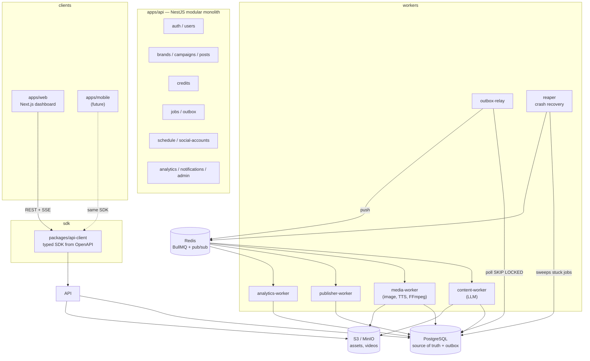

# RenderFlow

AI marketing studio and social scheduler. A business sets up a brand and a campaign
goal; AI produces captions, posters and short reels; the user approves, and a worker
publishes to social platforms on schedule. Usage is credit based — new accounts get
**50 free credits**, credits are reserved before work starts and refunded if
generation fails.

> **Status: 7 of 11 phases shipped** (0–4, 7, 8), 4 partial (5, 6, 9, 10). The
> credit engine, studio APIs, generation pipeline, scheduling, publishing and
> the browser frontend are built. The full browser journey passes locally
> (14/14, Chromium and a Pixel 7 viewport) and runs in CI against compose.
>
> The remaining gaps are deliberately unverified rather than quietly counted as
> done: no real AI provider or social platform has been called, chaos R5 needs a
> real SIGKILL, and no Grafana panel has rendered because this environment has no
> Docker daemon. See [`PHASES.md`](./PHASES.md) for the per-phase table and
> [`PROJECT.md`](./PROJECT.md) §12 for the plan and §13 for the test matrix.

---

## Architecture

**Modular monolith (NestJS) + separate worker processes, connected by Redis/BullMQ
and a transactional outbox.** Not microservices: credits need atomic DB transactions,
and one deployable is far easier to demo and reason about.



### Why this shape

| Decision                            | Reason                                                                                                                                                  |
| ----------------------------------- | ------------------------------------------------------------------------------------------------------------------------------------------------------- |
| Modular monolith, not microservices | Credits need multi-statement transactions and a single schema. Modules communicate via events, so any of them can be extracted later without a rewrite. |
| Separate worker _processes_         | Rendering and LLM calls are slow and bursty. Keeping them out of the API request path is what lets the API stay responsive and scale independently.     |
| Transactional outbox                | A DB write and its event commit together. `outbox-relay` pushes to BullMQ afterwards. If Redis is down, events wait in Postgres instead of being lost.  |
| Redis is never the source of truth  | Schedules and job state are persisted in Postgres, so Redis loss is recoverable.                                                                        |
| Shared typed SDK                    | `apps/web` and any future mobile app consume one generated client, so neither can drift from the API contract.                                          |

---

## Repository layout

```
apps/
  web/                  Next.js dashboard (App Router)
  api/                  NestJS modular monolith — all HTTP
  content-worker/       LLM tasks
  media-worker/         image, TTS, FFmpeg
  publisher-worker/     social publishing
  analytics-worker/     metrics sync
  outbox-relay/         outbox → BullMQ
  reaper/               stuck-job recovery + reconciliation
libs/
  common/               DTOs, enums, event contracts, zod schemas, queue names
  db/                   Drizzle schema, client, migrations
  queue/                BullMQ factories, retry presets
  storage/              S3 abstraction
  observability/        pino logger, prometheus metrics, process lifecycle
packages/
  api-client/           typed SDK generated from the API OpenAPI document
tests/                  e2e, integration, chaos
infra/                  docker, grafana, prometheus, scripts
```

Dependencies flow one way: `apps/* → libs/*` and `packages/*`, never the reverse.
Apps never import each other; they share `libs/common` or talk over queues.

---

## Getting started

### Prerequisites

- Node **22+** (tested on 24)
- pnpm **12+** (via `corepack enable`)
- Docker with Compose v2

### Setup

```bash
pnpm install
cp .env.example .env
docker compose up -d postgres redis minio minio-init mailhog
pnpm db:migrate
pnpm db:seed                # pricing_rules; without it generation returns 500
pnpm build
```

### Run

```bash
pnpm dev                    # all apps via turbo; loads .env automatically
pnpm db:migrate             # once, before the first compose boot
docker compose up --build   # full stack: api, web, and every worker
```

The compose stack reads JWT and token-encryption secrets from the root `.env`
through Compose interpolation; it refuses to start if any are missing. The API
and web ports are the only ones published (4000 and 3000). Infrastructure-only
work still uses the narrower command in Setup.

`pnpm dev` watches the TypeScript sources directly. The API and workers run under
`ts-node`, because Nest's decorator-based DI needs `emitDecoratorMetadata`, which
Node's built-in type stripping does not emit. Each app starts through
`scripts/dev-server.mjs`, which passes `--no-experimental-strip-types` only on the
Node versions that accept it (22.6+), so a run on an older runtime starts instead
of dying with `node: bad option`. The root `.env` is loaded with
Node's `--env-file-if-exists`, so a value already exported in your shell still
wins.

The `.env` you copy is the HOST configuration: it points `DATABASE_URL` and
`REDIS_URL` at `localhost`, because `pnpm dev` runs outside Docker. The compose
services do not read those values - `docker-compose.yml` gives every container
its own `postgres:5432` / `redis:6379` URLs.

| Service        | URL                                                 |
| -------------- | --------------------------------------------------- |
| Public landing | http://localhost:3000                               |
| Web dashboard  | http://localhost:3000/dashboard                     |
| API            | http://localhost:4000/api/v1                        |
| Health         | http://localhost:4000/health/live · `/health/ready` |
| Metrics        | http://localhost:4000/metrics                       |
| MinIO console  | http://localhost:9001                               |
| MailHog        | http://localhost:8025                               |
| Grafana        | http://localhost:3001                               |

The landing page is server-rendered and needs no session; the application shell
starts at `/dashboard`. The marketing design and its contrast checks live in
`design-system/renderflow/`.

### Commands

```bash
pnpm lint          # eslint (type-aware, strict)
pnpm typecheck     # tsc --noEmit across the workspace
pnpm test          # unit
pnpm test:coverage # unit + coverage gates
pnpm test:int      # integration, against a real Postgres
pnpm test:int:coverage # integration + coverage gate (what CI runs)
pnpm test:e2e      # Playwright against a running web + API (pnpm dev or compose)
pnpm test:chaos    # tests/chaos/run.sh — R1-R4; R5 needs Redis
```

---

## The credit system

Credits are the part of this project worth reading first.

1. **Signup grants 50 credits**, once per user, in the same transaction that creates
   the user. A unique constraint on `(user_id, 'SIGNUP_BONUS')` makes a duplicate
   grant impossible.
2. **Wallet = `available` + `reserved`**, both integers with a `CHECK (>= 0)`.
3. **Reserve before work.** Credits move `available → reserved` atomically with job
   creation and an outbox event, in one transaction. Insufficient balance means HTTP
   `402 INSUFFICIENT_CREDITS` and _nothing is created_.
4. **Capture on success** — `reserved` is released and the credits are spent.
5. **Refund on failure** — after retries are exhausted or on a permanent error,
   `reserved → available`, idempotent via `UNIQUE(reference_type, reference_id, entry_type)`.
6. **Only `libs/credits` may write to `wallets` or `credit_ledger`.** No other module
   runs SQL against those tables.
7. **Every movement is an append-only ledger row.** Wallet columns are caches, and
   `reconcile()` compares them to the ledger **per bucket**, because a single
   `SUM(amount)` cannot express two buckets:

   ```
   available = SUM(SIGNUP_BONUS, PURCHASE, ADJUSTMENT, REFUND) + SUM(RESERVE, EXPIRY)
   reserved  = -SUM(RESERVE, REFUND) + SUM(CAPTURE)
   ```

   `available + reserved == SUM(ledger)` is **not** the invariant - reserving moves
   credits between buckets without changing the total, so a total-based check
   passes while the wallet is wrong. `PROJECT.md` §5.10 has the arithmetic. The
   endpoint exists; nothing schedules it hourly yet (`PROJECT.md` Phase 5 gaps).

Pricing lives in the `pricing_rules` table, never in code and never on the client.
The table below is what `pnpm db:seed` inserts; the live rows win, and the public
pricing page reads them from `GET /credits/pricing` rather than restating this:

| Action                        | Credits |
| ----------------------------- | ------- |
| Content plan (7-day calendar) | 2       |
| Caption + hashtags set        | 1       |
| Poster / photo                | 5       |
| Carousel (up to 5 images)     | 15      |
| Reel ≤ 15 s                   | 30      |
| Reel 16–30 s                  | 50      |
| Regenerate one scene          | 8       |
| Caption translation           | 1       |

Publishing and scheduling are free. Only generation costs credits.

```
signup ──► available:50
reserve(30) ──► available:20, reserved:30
  success ──► reserved:0                  (CAPTURE)
  failure ──► available:50, reserved:0    (REFUND)
```

---

## Reliability mechanisms

The thesis of this system: **a crash at any point must never lose a job, double
charge, or double post.**

- **Transactional outbox** — DB write and event commit together; the relay publishes.
- **Heartbeat + lease** — a worker holds `locked_until = now() + 2m`, renewed every 30 s.
- **Reaper** (leader-locked, every 60 s) — recovers expired leases, re-enqueues
  orphaned `PENDING` jobs, reconciles `PUBLISHING` jobs against the platform.
- **Checkpointing** — each stage writes to S3 and `job_checkpoints`; a retry resumes at
  the first incomplete stage instead of redoing expensive work.
- **Idempotency at three levels** — `Idempotency-Key` on requests, unique keys on
  ledger rows, and an `external_post_id` check before any publish is retried.
- **DLQ + admin replay** — exhausted jobs are inspectable and replayable.
- **Graceful shutdown** — SIGTERM drains in-flight work before exit.
- **Token safety** — social tokens encrypted at rest (AES-256-GCM), never logged.

---

## Chaos testing

`tests/chaos/run.sh` automates R1-R4 (`PROJECT.md` §13.3) against a real database:
the exact state a killed worker leaves behind, the retry that resumes from a
checkpoint, the refund that must happen exactly once, and a reaper race. R5 - a
real `SIGKILL` - needs Redis and is reported as `SKIP`, which makes the script
exit non-zero on purpose. A chaos harness that reports PASS for what it did not
run is worse than none.

```bash
pnpm test:chaos
```

---

## Testing

| Layer       | Tool                  | Scope                                          |
| ----------- | --------------------- | ---------------------------------------------- |
| Unit        | Jest                  | credit math, state machines, pricing, adapters |
| Integration | Jest + Testcontainers | real Postgres/Redis; credit and queue logic    |
| Concurrency | Jest + `Promise.all`  | races on credits and publishing                |
| Chaos       | Bash + Docker         | worker kill, Redis/DB restart, SIGTERM         |
| E2E         | Playwright            | real user journeys against compose             |
| Load        | k6                    | throughput, queue drain time                   |

Gates: `libs/credits` and the state machines ≥ 95 %, overall ≥ 80 %. Mocks are used
for every external API — tests never call a real provider.

Current: **994 unit tests**, **482 integration tests** and 14/14 browser journeys
passing; 93.8 % lines / 85.2 % branches overall (unit).

---

## Configuration

Copy `.env.example` to `.env`. Notable values:

| Variable                   | Default             | Purpose                                   |
| -------------------------- | ------------------- | ----------------------------------------- |
| `AI_PROVIDER`              | `mock`              | `mock` \| `anthropic` \| `openai`         |
| `IMAGE_PROVIDER`           | `mock`              | `mock` \| `replicate` \| `fal`            |
| `TTS_PROVIDER`             | `mock`              | `mock` \| `elevenlabs` \| `openai`        |
| `SIGNUP_BONUS_CREDITS`     | `50`                | free credits at signup                    |
| `FAIL_STAGE` / `FAIL_RATE` | –                   | mock-provider failure injection for tests |
| `MOCK_LATENCY_MS`          | `0`                 | artificial mock latency; E2E uses 1500ms  |
| `S3_ENDPOINT`              | `http://minio:9000` | S3/MinIO                                  |

Local development and CI run entirely on mocks.

---

## License

Private project.
